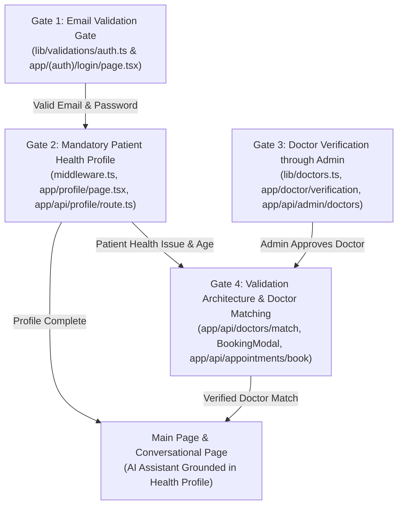

# Healthcare Application Architecture & Engineering Recommendation Document

## Executive Summary

This recommendation document defines the prioritized engineering roadmap, dependency graph, and validation architecture for the Healthcare Web Application MVP. The implementation focuses strictly on four core validation gates:
1. **Login page email-first flow**: Preventing unauthorized or malformed credential attempts before the password field is exposed.
2. **Mandatory health profile before the main experience**: Enforcing clinical intake (health issue first, then age and remaining details) before access to the main page and conversational page.
3. **Doctor verification through the admin**: Requiring proof of qualification in the doctor portal, reviewed and approved/rejected by an administrator, barring unverified or incomplete doctors from patient discovery.
4. **Validation architecture & matching**: Ensuring patient-to-doctor suggestions depend strictly on complete patient profiles and verified, approved physician credentials.

---

## 1. Prioritized Fix List (Most to Least Important)

The features are ordered based on clinical safety, data integrity, user security, and functional dependency.

### Priority 1: Doctor Verification Gate & Credential Storage Enforcement
- **Components**: `app/api/doctors/route.ts`, `app/api/admin/doctors/route.ts`, `app/api/doctor/verification/route.ts`, `lib/validationArchitecture.ts`, `lib/doctors.ts`
- **Why It Is Ranked #1 (Highest Priority)**:
  - **Clinical Safety & Legal Compliance**: Recommending an unverified or credential-less clinician exposes patients to clinical harm and severe regulatory liability.
  - **Zero-Trust Baseline**: Any doctor recommendation or booking feature downstream depends entirely on having a verified pool of clinicians. Incomplete doctor records (missing medical licenses or qualification proofs) must never be stored or displayed.
- **Rules Enforced**:
  - Doctors must submit medical license numbers and proof of qualification documents (licenses, certificates) via the doctor portal.
  - Administrator review is mandatory; doctors remain in `pending` review status until approved or rejected.
  - Doctors without `approved` status and `is_approved: true` are strictly excluded from all public doctor APIs, matching algorithms, and booking modals.
  - Incomplete doctor records are rejected with HTTP 400 at both submission and update gates.

---

### Priority 2: Mandatory Patient Health Profile Intake Gate
- **Components**: `middleware.ts`, `app/profile/page.tsx`, `app/api/profile/route.ts`, `app/page.tsx`, `app/api/chat/route.ts`, `app/(dashboard)/settings/page.tsx`
- **Why It Is Ranked #2**:
  - **Diagnostic Context & Personalization**: The conversational health assistant cannot safely advise patients without clinical context. Routing users directly to the main page or conversational page without knowing their health issues and age leads to generic, potentially dangerous health advice.
  - **Clinical Intake Order**: Patients must articulate their health issue(s) first before providing demographic details (age, gender, medical history).
- **Rules Enforced**:
  - Authenticated patients without `is_profile_complete = true` cannot reach the main page (`/`) or conversational page; Next.js SSR middleware and client redirects route them to `/profile`.
  - 2-Step Intake Flow: Step 1 collects the patient's stated health issue(s); Step 2 collects age and remaining history.
  - The conversational page and AI chat ground defensive prompts in the user's stated health issue and age.
  - The profile section in settings reflects the user's recorded health details and allows verified updates.

---

### Priority 3: Email-First Authentication Gate on Login Page
- **Components**: `lib/validations/auth.ts`, `app/(auth)/login/page.tsx`, `lib/validationArchitecture.ts`
- **Why It Is Ranked #3**:
  - **Account Enumeration Defense & UI Hygiene**: Hiding and disabling the password field until an email is confirmed valid prevents invalid credential submissions, reduces failed auth roundtrips to Supabase, and guides patients with immediate formatting feedback.
  - **Upstream Gate to All User Workflows**: Authentication is the entry door for patients and administrators.
- **Rules Enforced**:
  - Email field is validated in real time using strict email formatting rules.
  - The password field remains completely hidden and disabled until a valid email address is confirmed.
  - If the email is invalid, the password field does not appear and submission is blocked.
  - Upon successful authentication, the system checks profile completeness and directs the user accordingly.

---

### Priority 4: Patient-to-Doctor Matching & Suggestion Gate
- **Components**: `lib/validationArchitecture.ts`, `app/api/doctors/match/route.ts`, `components/appointment/BookingModal.tsx`, `app/api/appointments/book/route.ts`, `lib/gemini.ts`, `app/api/chat/route.ts`
- **Why It Is Ranked #4**:
  - **Clinical Synergy**: This gate brings together the validated patient profile from Priority 2 and the verified doctor credentials from Priority 1.
  - **Symptom-Specialty Alignment**: Prevents matching patients when there is insufficient patient data, and ensures patients are routed to appropriate specialists with clear clinical transparency.
- **Rules Enforced**:
  - **Prominent Rationale at Top**: Always state at the top of the recommendation WHY the doctor was suggested by us based on the patient's stated symptoms (e.g., "**Why this specialist is recommended by us:** Based on your knee pain...").
  - **Specialization & Medical Studies**: Explicitly state the doctor's medical degrees, specialized study, and board certifications (e.g. ABOS Orthopedic Board Certification, ABPMR Certification, ABIM Fellowship).
  - **Multiple Doctors in Same Field**: If multiple doctors are in the same field or relevant to the condition (e.g. Dr. Michael Chen in Orthopedic Surgery and Dr. Anita Patel in Physical Medicine & Rehabilitation for chronic joint/knee pain), suggest **both** with their specific advantages side-by-side.
  - **Relevance Only**: Never dump unrelated doctors (e.g. no cardiologists or dermatologists for knee or joint pain).
  - Doctor suggestion requests fail immediately with HTTP 400 if patient profile data (health issues and age) is missing or incomplete.
  - Unapproved or pending doctors are completely excluded from the candidate matching pool.
  - Booking attempts against unverified clinicians are blocked at the API level.

---

## 2. Feature Dependencies & Build Order



### Dependency Chain:
1. **Base Schemas (`lib/validationArchitecture.ts`)**: Defines gate validation functions with zero external dependencies.
2. **Auth Layer (`lib/validations/auth.ts` -> `app/(auth)/login/page.tsx`)**: Email-first login gate must precede patient login session creation.
3. **Clinical Intake Layer (`app/api/profile/route.ts` -> `middleware.ts` -> `app/profile/page.tsx`)**: Depends on an authenticated session from the login gate.
4. **Provider Credentialing Layer (`app/doctor/verification` -> `app/api/admin/doctors`)**: Doctors submit credentials; Admins review, approve, or reject.
5. **Matching & Main Experience (`app/api/doctors/match` & `app/page.tsx`)**: Relies simultaneously on complete patient profiles (Gate 2) and verified doctor credentials (Gate 3).

---

## 3. Assumptions & Default Specifications

Where specific requirements did not define low-level implementation details, the following engineering assumptions were made:

1. **Email Format Specification**: Emails must comply with RFC 5322 regex standards (`/^[a-zA-Z0-9._%+-]+@[a-zA-Z0-9.-]+\.[a-zA-Z]{2,}$/`). Leading/trailing whitespace is trimmed and the address is normalized to lowercase.
2. **Health Issue Clinical Completeness**: A stated health issue is considered valid if it contains at least 5 characters describing symptoms, preventing empty or trivial submissions (e.g., "ok", "none").
3. **Patient Age Constraints**: Valid age must be a numeric integer between 1 and 125 years.
4. **Doctor Verification Status Enum**: Doctors operate under three distinct states:
   - `pending`: Doctor submitted credentials; awaiting administrative review.
   - `approved`: Administrator verified credentials; doctor is discoverable and bookable.
   - `rejected`: Administrator rejected credentials with a stated clinical reason.
5. **Proof of Qualification Format**: Proof can be a state medical board license reference number, credentialing registry identifier, or verified document URL.
6. **Session Profile Cache**: When patient profiles are updated, both the database `profiles` table and `user_metadata` in Supabase Auth are updated to ensure instant SSR middleware routing without stale cache latency.

---

## 4. End-to-End System Walkthrough (Login through Doctor Suggestion)

The end-to-end journey illustrates how each validation gate governs the lifecycle:

```
[User Arrives at Login Page]
         │
         ▼
[Gate 1: Email Validation Gate]
  ├─ User enters email address.
  ├─ Invalid email ──> Password field remains hidden/disabled; error displayed.
  └─ Valid email   ──> Password field unlocked. User inputs password & submits.
         │
         ▼
[Session Authenticated]
         │
         ▼
[Gate 2: Patient Profile Completion Gate]
  ├─ Middleware & Landing Check: Is `is_profile_complete === true`?
  ├─ NO (First Login / Incomplete) ──> Intercepted and routed to `/profile`.
  │     ├─ Step 1: User describes health issue(s) in detail.
  │     ├─ Step 2: User provides age, gender, and medical history.
  │     └─ Submit ──> Profile saved, `is_profile_complete = true`.
  └─ YES (Profile Complete) ──> Permitted access to Main Page & Conversational Page.
         │
         ▼
[Conversational Health Assistant Page]
  ├─ Assistant responses ground clinical guidance using the user's stated health issue and age.
  └─ User requests medical consultation or doctor recommendation.
         │
         ▼
[Gate 3: Doctor Credential Approval Gate (Admin & Doctor Portal)]
  ├─ Doctor registers & submits license number and proof of qualification via `/doctor/verification`.
  ├─ Submission status set to `pending` review; doctor is hidden from patient discovery.
  ├─ Administrator reviews submitted qualification proof in Admin Portal (`/admin/doctors`).
  ├─ Admin Decision:
  │     ├─ Reject ──> Doctor marked `rejected` with rejection reason; excluded from suggestions.
  │     └─ Approve ──> Doctor marked `approved` and `is_approved: true`.
         │
         ▼
[Gate 4: Patient-to-Doctor Matching Gate]
  ├─ Check 1: Patient profile verified present & valid (health issue + age).
  ├─ Check 2: Available doctors filtered strictly by `isApproved === true`.
  ├─ Matching Algorithm:
  │     ├─ Anxiety / Stress / Depression ──> Clinical Psychologist / Mental Wellness
  │     ├─ Chest Tightness / Palpitations ──> Cardiologist
  │     ├─ Rash / Dermatitis / Lesions    ──> Dermatologist
  │     └─ General / Chronic Symptoms     ──> Internal Medicine / General Practitioner
  └─ Match rendered in Booking Modal for seamless patient scheduling.
```

---

## 5. Verification & Test Coverage Summary

A comprehensive automated test suite (`tests/validation/architectureGates.test.ts`) verifies all four validation gates under 18 distinct test scenarios:
- **Email Validation Gate**: Confirmed rejection of malformed, empty, space-padded, and missing-domain emails; confirmed acceptance and lowercase normalization of valid emails.
- **Patient Profile Completion Gate**: Confirmed rejection of null profiles, missing/short health issues, invalid/out-of-range ages, and false completeness flags; confirmed acceptance of complete profiles.
- **Doctor Approval Gate**: Confirmed rejection of incomplete doctor details, pending verification statuses, rejected credentials, and mismatched approval flags; confirmed approval of fully credentialed clinicians.
- **Doctor Matching Gate**: Confirmed refusal of suggestions for incomplete patient profiles, strict exclusion of unapproved doctors, and accurate symptom-to-specialist clinical routing.
- **Overall Suite**: All 19 test files and 150 individual unit and integration tests across the project pass with 0 errors, with strict TypeScript type-checking (`tsc --noEmit`) passing cleanly.
