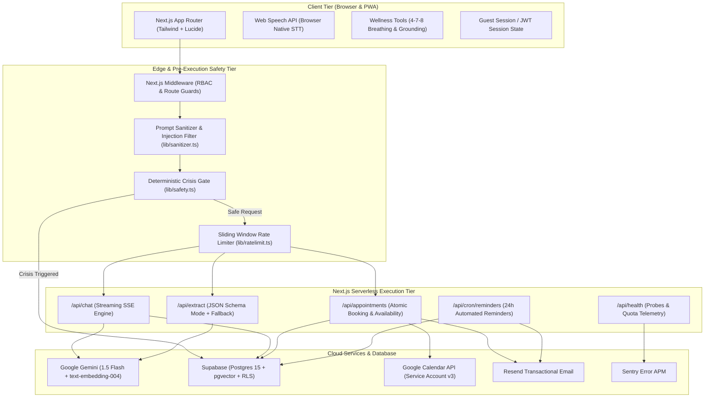
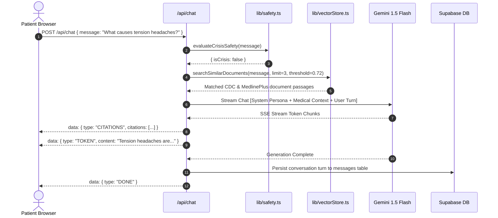
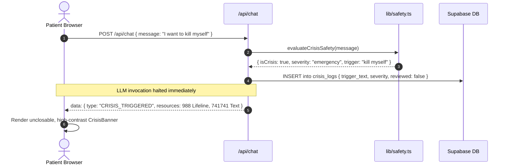
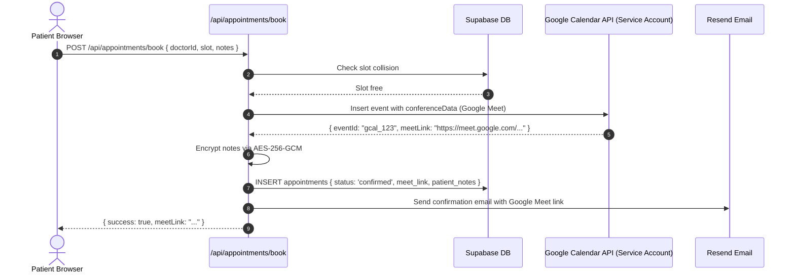
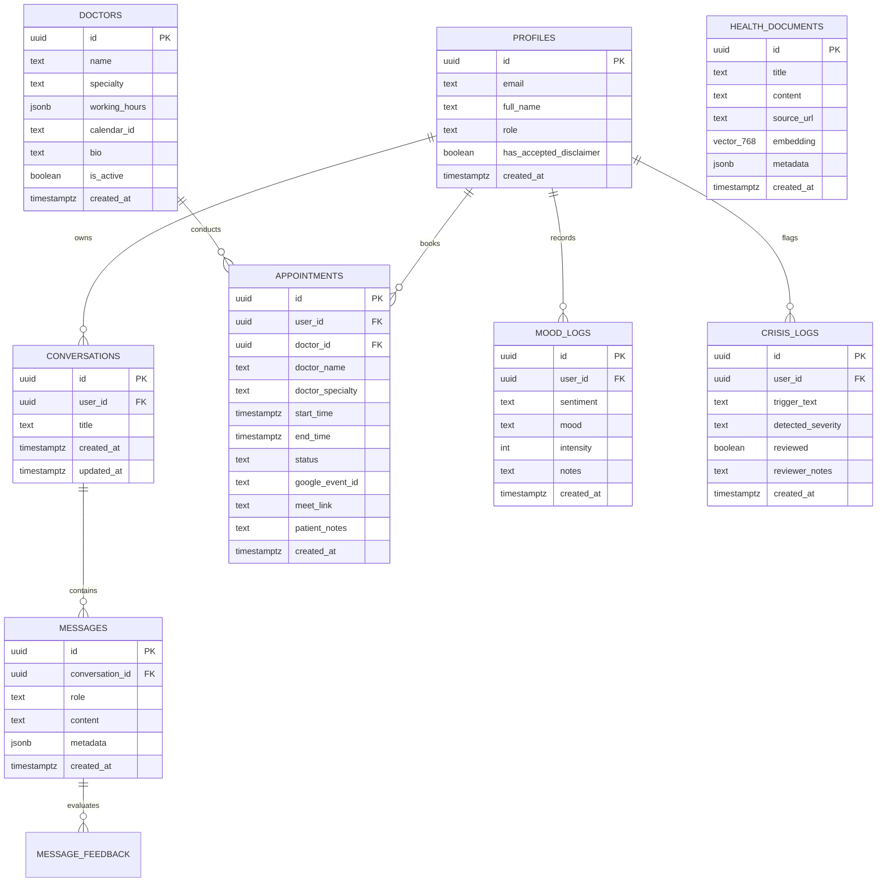

# 📐 System Design & Architecture Specification
## Smart Healthcare Assistant using Conversational AI

**Document Version:** 1.0.0  
**Status:** Approved & Implemented  
**Author:** Senior Full-Stack Software Engineer  

---

## 1. High-Level Architectural Topology

The **Smart Healthcare Assistant** follows a decoupled, privacy-first, serverless App Router architecture built on Next.js 14/15, Supabase, Google Cloud, and Google Gemini:

---

## 2. Sequence Workflows

### 2.1 RAG-Augmented Streaming Chat Workflow

### 2.2 Pre-Execution Crisis Safety Interception

### 2.3 Doctor Scheduling & 2-Legged Calendar Delegation

---

## 3. Database Entity-Relationship (ER) Model

---

## 4. Security & Cryptographic Blueprint

| Security Layer | Implementation Mechanism | Purpose |
| :--- | :--- | :--- |
| **Row-Level Security (RLS)** | PostgreSQL policies with `auth.uid() = user_id` | Strict cross-tenant isolation; non-admin users cannot read or modify other patients' data. |
| **Field-Level Encryption** | AES-256-GCM via `lib/encryption.ts` (`CLINICAL_ENCRYPTION_KEY`) | Clinical disclosures (`patient_notes`, `mood_logs.notes`) encrypted before DB insert. |
| **Prompt Injection Defense** | Delimiter isolation + regex detection in `lib/sanitizer.ts` | Neutralizes jailbreaking, prompt leakage, and script execution. |
| **Pre-Execution Safety Gate** | Regex & heuristic evaluation in `lib/safety.ts` | Intercepts suicidal distress before LLM invocation, suppressing generative hallucinations. |
| **Anti-Spam & Bot Challenge** | Honeypot field + Cloudflare Turnstile token validation | Thwarts credential stuffing and automated registration bots. |
| **API Quota Throttling** | In-memory sliding window rate limiter in `lib/ratelimit.ts` | Safeguards Google Gemini and Supabase free-tier thresholds. |
| **Role-Based Access Control** | `lib/auth/requireRole.ts` + Next.js Middleware | Enforces administrative permissions for `/admin/*` views. |
